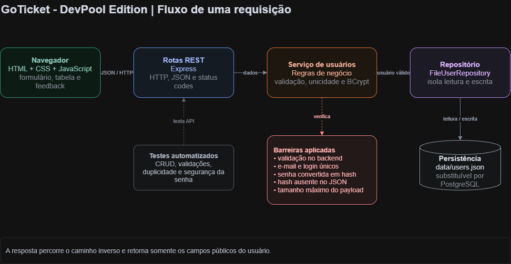

# GoTicket - DevPool Edition

Sistema Full-Stack de gerenciamento de usuários, desenvolvido como projeto demonstrativo para o DevPool 2027.

O GoTicket surgiu da necessidade de organizar processos de atendimento e tornar as operações mais claras, estruturadas e rastreáveis. Nesta edição, o projeto apresenta uma aplicação de gerenciamento de usuários, com operações completas de CRUD, interface responsiva e API REST.

> **Dados e segurança:** este repositório utiliza exclusivamente dados fictícios e não contém credenciais, informações de clientes ou integrações corporativas privadas.

## Tecnologias utilizadas

| Camada        | Tecnologias                  |
| ------------- | ---------------------------- |
| Frontend      | HTML5, CSS3 e JavaScript     |
| Backend       | Node.js e Express            |
| Persistência  | Arquivo JSON                 |
| Segurança     | BCrypt                       |
| Identificação | UUID                         |
| Testes        | Node Test Runner e Supertest |

## Funcionalidades

- Cadastro de usuários;
- Listagem e pesquisa de usuários;
- Consulta por identificador;
- Edição de informações cadastrais;
- Alteração de status (ativo/inativo);
- Exclusão de usuários com confirmação;
- Validação de dados no frontend e backend;
- Verificação de e-mails e logins duplicados;
- Proteção de senhas com hash BCrypt;
- Feedback visual de carregamento, sucesso e erro;
- API REST com suporte a CORS.

## Arquitetura do projeto

O sistema foi desenvolvido utilizando uma arquitetura em camadas, separando responsabilidades para facilitar a manutenção, os testes e futuras evoluções.



O arquivo editável do diagrama está disponível em [`docs/architecture.drawio`](docs/architecture.drawio).

```text
GoTicket/
├── public/
│   ├── index.html
│   ├── styles.css
│   └── app.js
│
├── src/
│   ├── app.js
│   ├── server.js
│   ├── config.js
│   ├── routes/
│   ├── services/
│   ├── validators/
│   ├── repositories/
│   └── middleware/
│
├── test/
│   └── users.api.test.js
│
├── docs/
│   ├── architecture.drawio
│   ├── assets/
│   │   └── architecture.png
│   └── presentation-guide.md
│
├── data/
├── .env.example
├── package.json
└── README.md
```

## Como executar o projeto

### Pré-requisitos

- Node.js 20 ou superior;
- npm.

### 1. Clonar o repositório

```bash
git clone https://github.com/Legooh/devpool.git
```

### 2. Acessar a pasta

```bash
cd devpool
```

### 3. Instalar as dependências

```bash
npm install
```

### 4. Iniciar a aplicação

```bash
npm run dev
```

A aplicação estará disponível em:

http://localhost:3000

O arquivo de persistência `data/users.json` é criado automaticamente na primeira execução.

## Configurações opcionais

O projeto possui um arquivo `.env.example` com as configurações disponíveis.

| Variável             | Padrão            | Descrição                   |
| -------------------- | ----------------- | --------------------------- |
| PORT                 | 3000              | Porta do servidor           |
| DATA_FILE            | ./data/users.json | Caminho do arquivo de dados |
| PASSWORD_SALT_ROUNDS | 10                | Custo do hash BCrypt        |

Caso deseje personalizar as configurações, copie `.env.example` para `.env` e carregue as variáveis no processo Node.js.

## API REST

A aplicação disponibiliza os seguintes endpoints:

| Método | Endpoint      | Descrição                              |
| ------ | ------------- | -------------------------------------- |
| POST   | `/users`      | Cadastrar usuário                      |
| GET    | `/users`      | Listar usuários                        |
| GET    | `/users/:id`  | Consultar usuário                      |
| PUT    | `/users/:id`  | Atualizar usuário                      |
| PATCH  | `/users/:id`  | Atualizar campos específicos           |
| DELETE | `/users/:id`  | Excluir usuário                        |
| GET    | `/api/health` | Verificar disponibilidade da aplicação |

### Exemplo de cadastro

```bash
curl -X POST http://localhost:3000/users \
  -H "Content-Type: application/json" \
  -d '{
    "name": "Ana Souza",
    "email": "ana@empresa.com",
    "login": "ana.souza",
    "password": "senha-segura",
    "active": true
  }'
```

## Regras de negócio e segurança

- Identificadores únicos gerados por UUID;
- Nome obrigatório, com mínimo de 3 caracteres;
- E-mail obrigatório, válido e exclusivo;
- Login obrigatório, com mínimo de 3 caracteres e exclusivo;
- Senha obrigatória no cadastro, com mínimo de 8 caracteres;
- Senhas armazenadas exclusivamente como hash BCrypt;
- Novos usuários cadastrados como ativos por padrão;
- Validação dos dados antes da persistência;
- Respostas HTTP adequadas para erros de validação e registros inexistentes;
- Dados sensíveis, como senhas e hashes, não são expostos pela API.

## Persistência de dados

Para facilitar a execução e demonstração do projeto, foi utilizado armazenamento em arquivo JSON.

A camada de repositórios é responsável por toda a persistência dos dados, mantendo essa responsabilidade separada das demais partes da aplicação. Essa organização facilita futuras mudanças, como a adoção de um banco de dados PostgreSQL, sem impactar diretamente as regras de negócio e as rotas da API.

## Testes automatizados

Para executar os testes:

```bash
npm test
```

A suíte de testes contempla:

- Operações completas de CRUD;
- Validação dos campos obrigatórios;
- Identificação de e-mails e logins duplicados;
- Consulta de usuários inexistentes;
- Proteção e armazenamento de senhas;
- Ausência de dados sensíveis nas respostas;
- Funcionamento do CORS;
- Tratamento de rotas inexistentes.

## Documentação complementar

O projeto também disponibiliza materiais para facilitar a compreensão da solução:

- `docs/architecture.drawio`: diagrama editável da arquitetura;
- `docs/presentation-guide.md`: roteiro de apresentação e demonstração.

O diagrama pode ser aberto pelo [diagrams.net](https://app.diagrams.net/).

## Objetivo do projeto

Demonstrar conhecimentos em desenvolvimento Full-Stack, construção de APIs REST, organização de código, validação de dados, segurança, persistência e testes automatizados.

---

**GoTicket — DevPool Edition**

Projeto desenvolvido para o DevPool 2027.
